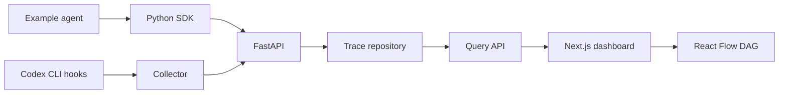

# Architecture overview

## Goal

Prove that No More 500s can ingest observable AI-agent execution events and
reconstruct a useful execution graph before implementing advanced detection or
analytics.

## Initial data path

The API selects a repository at startup. Local development defaults to ClickHouse
so runs survive API restarts. Isolated unit tests inject the in-memory repository.
ClickHouse persists batch traces in MergeTree tables and live telemetry in an
append-only `run_events` log. Queries reconstruct live runs from that log and
only return batch spans that share the committed header `ingestion_id`.

## Boundaries

- **SDK:** Creates and exports vendor-neutral trace payloads. It does not know
  about the dashboard or database.
- **API:** Validates payloads and coordinates storage. Routes do not contain
  storage queries.
- **Contracts:** Define stable, language-neutral event shapes.
- **Dashboard:** Reads only the public API and maps spans into nodes and edges.
- **Detectors:** Pure functions consume reconstructed traces and emit
  diagnostic findings. They do not mutate raw telemetry. See
  [diagnostics.md](diagnostics.md).

## Privacy boundary

The platform records explicit application inputs, outputs, tool activity, and
metadata supplied by the customer. It does not claim to capture or reconstruct
a model provider's private chain-of-thought reasoning.

## Deferred work

- API keys and multi-tenant authorization
- Schema migrations for future telemetry contract changes
- Redis until caching or asynchronous ingestion is justified
- OTLP exporter and framework integrations
- Production deployment and operational controls
- Semantic (non-exact) loop detection and LLM-authored explanations
